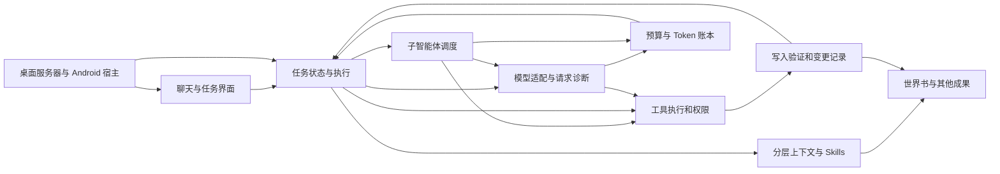

# SillyTavern-Agent 技术可行性调查总结

调查基于 V1.0 产品蓝图，共追踪 166 项要求。SillyTavern 1.19.1 已有聊天、提示词组装、工具回合、世界书文件和扩展入口。在未改造宿主上加载工作台后，模型桩的七次工具操作完成了跨条目读写和校验，新内容出现在后续请求的原生世界书提示词中。真正的长期任务还需要自己的执行状态、授权、工作区并发控制和请求收尾语义。 [原生能力](SillyTavern原生能力调查.md) · [需求矩阵](功能可行性矩阵.md) · [实际验证](核心功能验证报告.md)

优先处理的技术问题有两个。第一，世界书原生编辑以整书保存且缺条件版本，HTTP 失败时同页缓存仍可更新，两个浏览器上下文也实测了旧副本整书覆盖。第二，Vertex 适配在已知模型名和别名上会生成不同媒体、思考和采样行为，并会在函数声明存在时移除 Google Search。两项均可在本地重现，若直接建立长任务、回滚或再加渠道，错误会传播到多个后续子系统。 [世界书 N12–N13](SillyTavern原生能力调查.md) · [适配 M01–M08](模型与API能力调查.md) · [T04–T05](核心功能验证报告.md)

## 输入、版本及协作规范

| 仓库 | 分支与实际版本 | 提交与用途 |
| --- | --- | --- |
| SillyTavern-Agent | release，1.19.1，产品蓝图／功能总览 V1.0 | [c231775301a067439b0c3d3bbbf926021789537d](https://github.com/cjhkcjgk3-sys/SillyTavern-Agent/commit/c231775301a067439b0c3d3bbbf926021789537d) |
| SillyTavern 官方 | release，1.19.1。同日查询 staging 为 `c96a1d0c6a8fccf458591829146f9df4acea4d9f`，调查执行使用 release | [82b64a45c34facbc98ff4b9f33c067d3ccab6a17](https://github.com/SillyTavern/SillyTavern/commit/82b64a45c34facbc98ff4b9f33c067d3ccab6a17) |
| 世界书协作工作台 | main，manifest 0.1.0 | [13c5258214f08be88c97ae75f360761b3f94dfdc](https://github.com/cjhkcjgk3-sys/sillytavern-worldbook-workbench/commit/13c5258214f08be88c97ae75f360761b3f94dfdc) |
| SillyDroid | master，源码。以 Tavern 1.19.1 解析出候选宿主 1.0.1.69 | [725b5938ab17e1f8181b375affc4a23588f8845b](https://github.com/jialmaster/SillyDroid/commit/725b5938ab17e1f8181b375affc4a23588f8845b) |
| ai-dev-lessons | main，正式规则库按 SHA 标识 | [dde4e7e9e71c75ef8ae5fd7f251fc5d5e4b20ef9](https://github.com/cjhkcjgk3-sys/ai-dev-lessons/commit/dde4e7e9e71c75ef8ae5fd7f251fc5d5e4b20ef9) |

逐份读取了主项目两份产品文件与 CONTRIBUTING、经验库正式区的通用准则、方法 01–16、流程、检查清单、所有模型专项和两份案例，以及工作台协作规范与问题记录。主项目在调查时仅有远程 `release`，项目树无 AGENTS 或 NEXT。经验库中相关条目为方法 02、08–10、12–16 和 WB-17、WB-24、WB-26。TavernWeave 采用代码质量及 API 参考路线，核对世界书版本参考和宿主执行规则。云端 A0 指南文件未能读取，手工路由的目标、范围和验收以任务与项目正式规则核对，无设计候选。 [主项目贡献规范](https://github.com/cjhkcjgk3-sys/SillyTavern-Agent/blob/c231775301a067439b0c3d3bbbf926021789537d/CONTRIBUTING.md) · [正式规则](https://github.com/cjhkcjgk3-sys/ai-dev-lessons/tree/dde4e7e9e71c75ef8ae5fd7f251fc5d5e4b20ef9/正式)

## 功能可行性与可复用范围

| 能力 | 结论 | 证据边界 |
| --- | --- | --- |
| 普通聊天、现有生态和统一入口 | 可直接复用聊天、卡片、消息、预设、原生激活和扩展入口。Agent 模式、任务状态和跨页面恢复需要扩展。 | 真实未改造基线已运行，Playwright 3 项原生思考编辑失败，尚待上游定位。 |
| 持续工作、工具、审批和子智能体 | 工具发现/执行/回送可扩展复用。自主下一步、任务暂停恢复、后台运行、独立子智能体及资源计账有条件可行，需补任务运行器。 | T02 实测有界工具递归。T06、T08、T09、T16 仅证明原型机制。 |
| 工作区与版本 | 单书搜索、读取、写入及撤销可复用工作台。多书并发、任务回滚、历史同步需存储与写入边界改造。 | T02–T04、T18 本地宿主。T07、T15 在原型验证事务/补偿思路。 |
| 四层上下文、技能与记忆 | 原生预设、作者注释、Token 计算、Summarize、向量检索可作为已有机制。四层组织、专项技能目录、引用版本和反复压缩保真需新能力。 | T10 是有标注的确定性压缩，无真实模型保真及成本结论。 |
| 模型、渠道与观察 | 多渠道已具备各自适配。独立能力配置、出站诊断、失真修补和账本有条件可行。 | Custom 桩与 Vertex 代理桩各有证据。真实 Vertex/正式渠道、服务地区和功能联合能力待验。 |
| MCP 与插件协作 | 可以通过显式注册和 SDK 桥接。授权、外部传输、输入校验及现存插件能力边界需补。 | T11 实测 SDK 内存路径和授权前检查。 |
| Android 本地与远程 | 远程可复用服务端核心与 Web UI。本地可用 SillyDroid 作为源码/打包参考。共同满足原生生态、恢复和许可需联合验证。 | T12 只有构建计划。T17 三个窄屏视口的确认按钮初始在屏外。真实 Android 和 APK 未验证。 |

详细模块、维护负担和许可证见[候选及 Android 证据](现有插件与开源项目调查.md)。最先复用的单位是原生文件/聊天操作、工具协议、工作台的查读/提案/字段保留逻辑、现有差异组件。后端运行时可用 AI SDK、LangGraph、内置 SQLite 作小范围对照。MCP SDK 与 Agent Skills 规范适合分别承担协议和文档格式边界。

## 全局依赖与连锁影响

共同设计的边界是任务、工具和工作区写入。一次操作需要可追溯的用户、任务、尝试、目标对象/修订、授权及回执。审批、取消、重试、子任务和回滚都依赖它。模型请求与上下文压缩也需共同定义工具回合、思考签名、输入预算、模型停止原因和统计口径。调整发送链上的提示词或世界书缓存会同时影响普通聊天、扩展及任务。 [N06–N13](SillyTavern原生能力调查.md) · [M05–M08](模型与API能力调查.md)

可相对独立验证的工作包括只读工作区检索、差异视图、MCP 协议客户端、模型能力配置样本和 Android 构建计划。最终交互仍依赖任务状态与权限。后端插件、核心改造和独立运行模块都能进入下一阶段比较，已有证据可用源码与原型收窄各自的边界。 [边界对比](SillyTavern原生能力调查.md)

## 主要风险

| 风险与严重度 | 条件、影响和实际证据 | 下一阶段应核对 |
| --- | --- | --- |
| 旧数据覆盖及缓存失真 · 高 | 两个调用者保存同一本书，或 HTTP 500。N12/N13 显示整书覆盖及预更新缓存，T04 实测缓存领先于文件。影响工具、原版激活、人工操作、子任务和回滚。 | 按对象/修订进行条件提交，明确所有原生入口缓存失效与冲突策略。保留 T18 双页回归，确认条件提交后两页结果一致。 |
| 保存后中断与跨书部分成功 · 高 | 外部存储与任务记录分离时，进程可在写入后停止。T06/T07 证明同事务行为，T15 显示跨存储需对账且补偿也会冲突。 | 按操作身份、回读和结果状态恢复。试磁盘故障、后续人工修改和两个实际文件。 |
| 过期授权和不可信工具数据 · 高 | 工具可用列表与实际写入之间，用户可能切换工作区或撤回权限。网页、世界书及 MCP 结果经过模型再决定动作。W01/W04 支持一部分检查，T08/T11 仅演示受控原型。 | 每次执行检查任务范围和权限，审批绑定修订，子权限取交集。合成内容验证越权被拦截和日志脱敏。 |
| 模型适配静默偏差 · 高 | 别名、版本、地区、思考、工具与搜索组合触发不同过滤。T05 捕获真实适配器在回环上的差异。费用和完成原因也会丢失。 | 建立出站与响应契约探针，真测 Vertex Express/Full，原版各渠道回归。 |
| 执行恢复及未停止消耗 · 高 | 网络断开、服务重启、用户暂停时，旧请求或外部操作仍可能继续。N08 是前端有限周期，T09/T16 表明取消/预算原型可用。 | 预扣预算、限制并发、晚到结果归属、按回执甄别已执行状态。验证 HTTP 取消、重启和 API 账单。 |
| 长期记忆衰减或重复注入 · 高 | 多次总结或切换提示词，关键否决、决策、工作状态和最新成果可能丢失。N10 只给摘要机制，T10 使用预标注样本。 | 建立真实创作语料和人工事实集，比较摘要迭代、来源可追溯性、费用和缓存。 |
| Android 进程回收与生态差异 · 高 | 息屏切换、OEM 省电、不同内核和本地 Node/ABI 会影响网络与后台。D01–D04 为源码和计划，T14 环境受限。 | 先区分本地和远程，真机复验前台服务、中断恢复、触屏和持久存储。 |
| 上游合并及许可证 · 高 | 生成、工具、提示词、数据文件是多方共用路径，SillyDroid 和 Tavern Helper 含非商用许可。原版 E2E 已有 3 项失败。 | 用固定分支维护兼容矩阵。涉及分发/商用单独核对权利。采用目标发布包验证。 |

## 可按证据推进的验证顺序

1. 固定普通聊天黄金样本与连接配置，完成 Vertex 出站/停止/用量证据。并行核实世界书条件写、真实双标签页和写后失败。两条链都已经有基线，可在选择运行方式之前检验。
2. 以单世界书和单任务验证完整生命周期。先贯穿授权、审批、任务状态、实际落盘、重启对账和工具结果再入模，逐步增加步数和预算。
3. 扩展到多书与多写者，再加子任务和 MCP。确认外部副作用、任务终止、权限继承及失败补偿后，比较运行机制的维护成本。
4. 用真实模型和标注创作语料评估四层上下文、技能按需加载、压缩、检索、缓存和有效工作成本。保持普通聊天回归及持久化恢复的独立比较。
5. 在手机远程和本地宿主分别验证。检查构建包、双内核、后台、中断恢复、导入导出、兼容插件和对应分发义务。

以上是调查后的验证和开发顺序建议。报告和实验都保存在 `docs/research/A/`，供独立复核。实际产品架构、功能取舍和准入由后续阶段决定。 [十项跨功能场景](核心功能验证报告.md) · [复现目录](verification/README.md)
